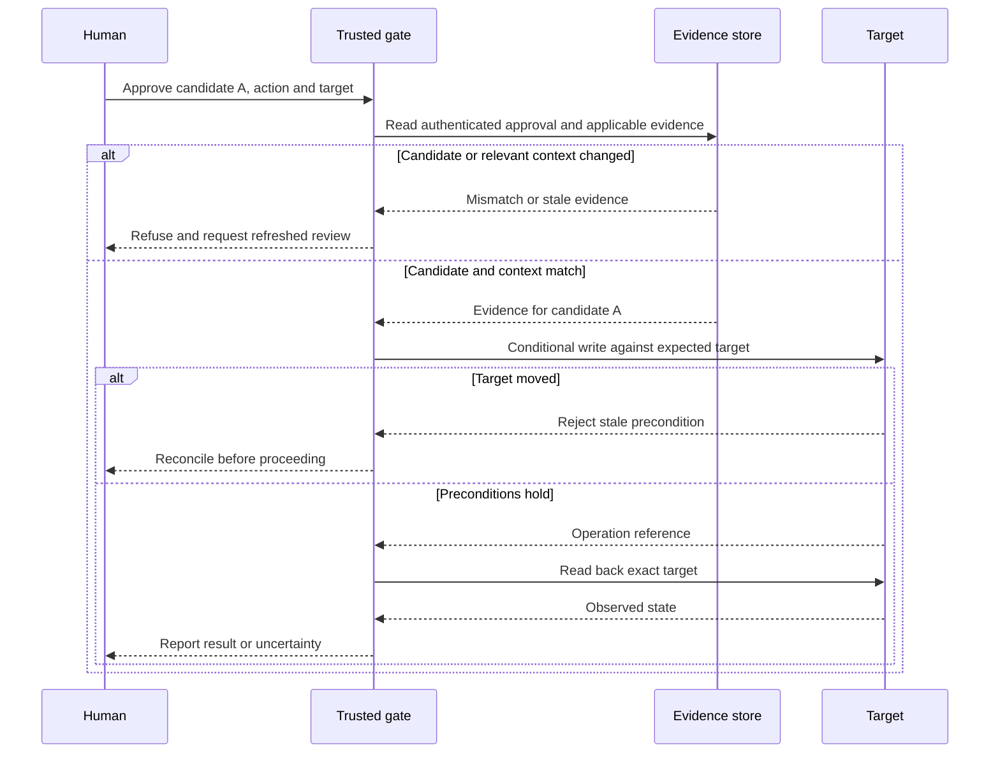
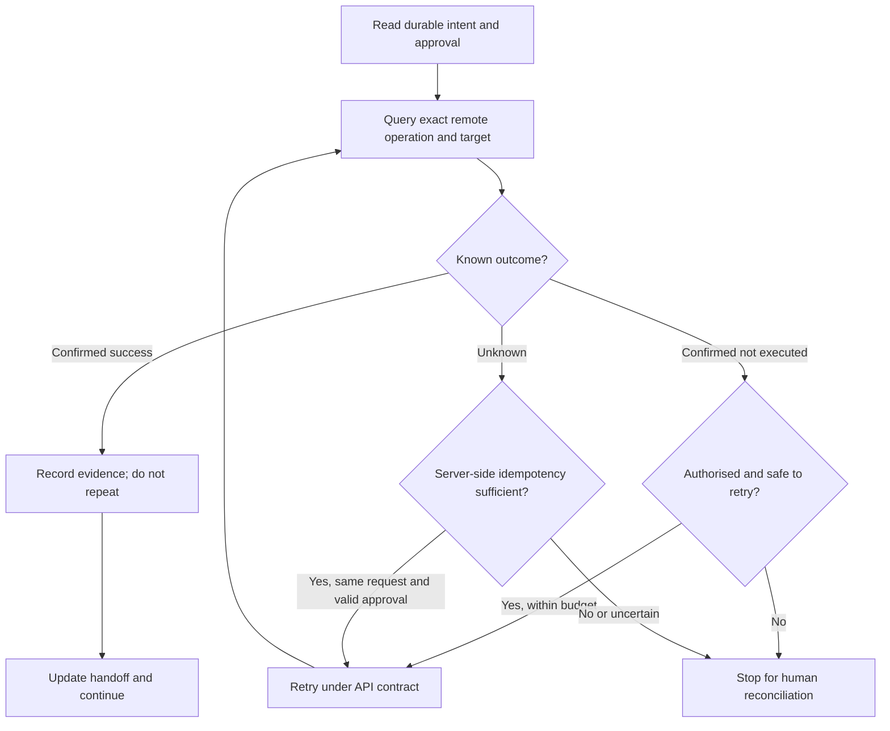

An approval can be genuine and still apply to the wrong code. A test can pass and still stop at a mocked boundary. An agent can lose its response to an external write even though the write succeeded.

These are the cases I want an agentic development workflow to handle before I give it more autonomy. A longer planning document does not resolve them.

My earlier [software factory design](/posts/software-factory-evidence-first/) described the division of work between people, agents, reusable tasks, and individual runs. This article narrows that design to three contracts: what an approval authorises, what recovery must reconcile, and what counts as evidence.

The starting point was a document review, followed by an independent second-model review. That found design questions, not production results. The mechanisms below are proposals for a bounded pilot, not claims that I have deployed a complete enforcement system or measured a productivity gain.

## Separate intent from authority

A lifecycle diagram usually looks reassuring: plan, implement, test, review, deploy. The arrows hide a question: does reaching the next state grant permission to perform its action?

It should not.

I can authorise an agent to implement a fix without authorising it to push a branch. I can approve a merge without approving a production deployment. A workflow needs to represent those distinctions even if one person makes every decision.

Anthropic's [AI-native SDLC playbook](https://claude.com/blog/the-ai-native-sdlc-playbook) proposes a connected lifecycle built around committed artifacts and feedback. I find that useful as an organising model. Its claims about throughput are not evidence that my own workflow is faster, and I would not turn every small fix into a separate intent, specification, plan, and decision document.

For a small, reversible change, I would start with one record:

- **Brief:** the user problem, scope, and non-goals.
- **Contract:** acceptance criteria, permitted actions, risk boundaries, and stop conditions.
- **Evidence:** the candidate version, observed results, independent review, and outstanding decisions.

These can be sections of a ticket. A schema migration or security-sensitive change needs more detail. Calling it a chore does not lower its risk.

## Bind approval to the candidate, action, and target

Consider an illustrative sequence. A reviewer approves candidate A. The agent adds a follow-up commit, producing candidate B. The dashboard still shows a green check, and the conversation still contains “approved”.

Nothing has necessarily gone wrong with the people. The record has lost the relationship between the decision and its subject.

An approval should identify the work, the exact candidate, the action, and the target. An evidence record should identify what was actually tested. The following YAML is a proposed shape, not an executable configuration. Angle-bracket values are placeholders, not real identifiers:

```yaml
approval:
  task_id: "<task identifier>"
  repository: "<repository identifier>"
  candidate_sha: "<full commit object ID>"
  spec_version: "<versioned acceptance contract>"
  action: "merge"
  target: "<target branch>"
  expected_target_sha: "<full target object ID>"
  approver_ref: "<authenticated human approval reference>"
  evidence_refs:
    - "<immutable evidence record>"

evidence:
  tested_sha: "<full commit object ID>"
  environment_ref: "<versioned test environment>"
  config_ref: "<relevant configuration version>"
  command_ref: "<test invocation>"
  result: "passed"
  artifact_ref: "<access-controlled output reference>"
```

A deployment needs a deployment-specific record, including the artifact digest and destination. A merge approval is not a reusable deployment credential.

The equality checks are only the beginning. A field called `approver_ref` proves nothing if the executing agent can write it. The execution boundary must authenticate the approval through a record or service that the worker cannot impersonate. The same applies to evidence: a worker-authored `result: passed` is not an independent test result.

I would invalidate the affected approval or evidence when its candidate, acceptance contract, or relevant target context changes. That does not mean reapproving the entire task after an unrelated spelling correction. It means defining which changes affect which claims.

The tested object also needs care. A CI run against a synthetic merge candidate is not automatically a run against the PR head, and neither is automatically proof about the eventual deployed artifact. Record the actual object and its relationship to the candidate rather than relabelling it for convenience.



Checking the branch and then writing later leaves a race. The final operation needs a service-supported precondition or an equivalently protected executor. If the target cannot provide that guarantee, I would not pretend the diagram provides it.

A Git worktree helps keep unrelated file changes apart. It does not confine credentials, network access, or the authority to merge. Those require a separate security boundary.

## Recover by reconciling, not replaying

A useful handoff records the branch, candidate, assumptions, completed checks, and next action. That is enough to resume many read-only steps. It is not enough to resume an uncertain external write.

Suppose an agent submits an operation and loses the connection before recording the response. There are three states worth distinguishing:

1. The operation is confirmed successful.
2. It is confirmed not to have executed.
3. Its outcome is unknown.

A timeout belongs in the third category. A temporarily empty lookup may belong there too, especially when the remote system is eventually consistent.

Before an authorised write, I would persist an operation record containing a stable operation ID, the exact target, the request identity, and the applicable approval. If that record cannot be saved, the write should not proceed. Afterward, the record gets the remote identifier and exact-target readback.

On recovery, the first action is a query, not a repeat of the previous command.



A local operation ID does not make an external API idempotent. The service must support the relevant contract, including what happens when the same identifier is reused with different parameters or outside its retention window. Amazon's [Making retries safe with idempotent APIs](https://aws.amazon.com/builders-library/making-retries-safe-with-idempotent-APIs/) explains this distinction through caller-provided request identifiers and reconciliation.

Read-only checks can usually have bounded retries. An in-scope test failure can enter a bounded repair loop. An unknown side effect, changed permission boundary, or exhausted budget should stop the run. “Ask a human after every failure” is too expensive; “retry until green” is too permissive.

## Make evidence narrower and stronger

The question is not whether another agent agrees with the implementation. It is whether the acceptance claim survives a check grounded outside the implementation's own explanation.

For an illustrative learner-progress fix, I would distinguish these claims:

- A unit test proves the local update rule for the supplied cases.
- A contract test checks the payload against the agreed interface.
- A browser test with a mocked reporting service checks the UI and request path up to that mock.
- A controlled integration test with the real service checks a different boundary.

Those are useful but different results. Calling the browser test “E2E” does not extend its evidence beyond the mock.

The verifier should start with the original symptom and acceptance criteria, then inspect the necessary code, tests, and contracts. I would avoid leading with the implementer's conclusion. I would not prevent the verifier from reading relevant context in the name of independence.

A second model is helpful for finding missing assumptions. It cannot turn a document review into runtime verification, and two models can share the same mistaken premise. Useful independent oracles include an agreed interface contract, a preserved regression case, or a known expected result supplied independently of the proposed fix.

Humans still need to inspect risk-sensitive diffs. Tests do not remove the need to review a permission change or a destructive migration. The aim is to make that review focused and well supported, not to declare code review obsolete.

## Keep the audit trail smaller than the transcript

I want to reconstruct why an action happened, what authorised it, and what was observed. I do not need every byte the agent saw.

Full session transcripts and command outputs can contain credentials, personal data, request headers, or customer content. Automatically committing them creates another system to secure and eventually clean up.

My default would be an allowlisted, redacted summary with controlled evidence references. Raw artifacts, when needed, belong in restricted storage with an owner, access policy, retention period, and deletion process. A path and a checksum do not protect the referenced file. Secret scanning is useful, but not a substitute for deciding what should be collected.

This also keeps the sources of truth clearer: Git owns code versions, the test system owns its observed result, the approval boundary owns the decision, and the task record links them. A knowledge index is a retrieval aid, not the authority to act.

## A reversible slice still needs a recovery plan

A thin vertical slice is a good way to learn quickly. It is not proof that everything it does can be undone.

[Git revert](https://git-scm.com/docs/git-revert) records changes that reverse earlier commits. It does not retract a notification, restore an external account, or repair data already consumed downstream.

For a consequential slice, I would name the recovery mechanism: code rollback, configuration disable, data restoration, compensating action, or forward repair. I would also identify the point after which an ordinary code rollback is insufficient.

Temporary compatibility layers need an exit condition. An expand-migrate-contract change may deliberately leave old and new paths in place. That is sensible only if someone owns the removal condition and review point. The cleanup can be a later approved slice; it should not be forced into the first change merely to make one PR look complete.

## The pilot I would run next

I would use one familiar repository, one real reversible regression, and one implementation stream. No infrastructure changes, data migration, or automatic production release. One task record should be enough.

Before starting, I would agree the implementation scope, acceptance oracle, human review budget, and stop conditions. Then I would reproduce the failure, make a meaningful red test green, run the focused suite and critical-boundary smoke, and ask for independent verification at the exact candidate.

Two failure exercises matter as much as the happy path: reject evidence from an old candidate, and resume safely after an interrupted read-only step. Any later test of uncertain writes should start with a controlled fixture, not a production experiment.

I would record human review time, elapsed time, rework, acceptance coverage, and external mutations. If there is no comparable historical baseline, the first task establishes one. A single successful run cannot demonstrate a lower defect rate or a reliable productivity improvement.

I would stop when the task crosses an unapproved security, data, or API boundary, when evidence cannot be reproduced, or when the agreed budget runs out. The next approval must come from the person who owns the decision, not from the agent's confidence that another attempt will work.

The useful unit of progress is an accepted outcome with applicable evidence. More agent activity is easy to generate. Authority that survives code changes, recovery that survives lost responses, and evidence that answers the original question are harder. Those are the parts I would prove first.
